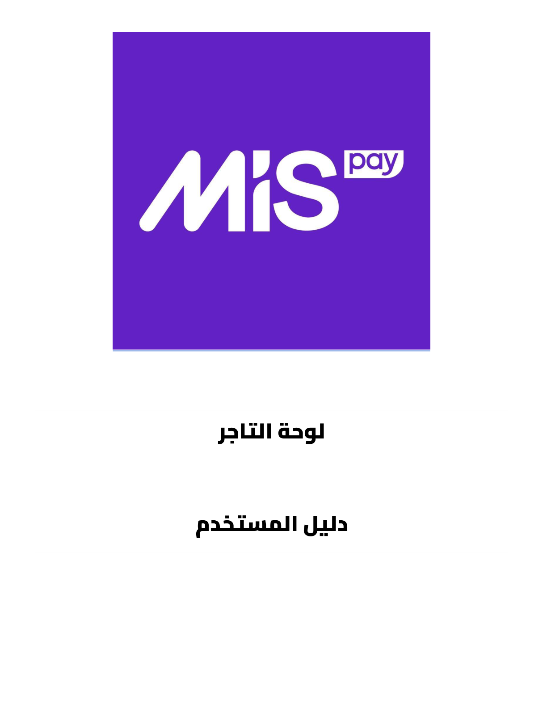
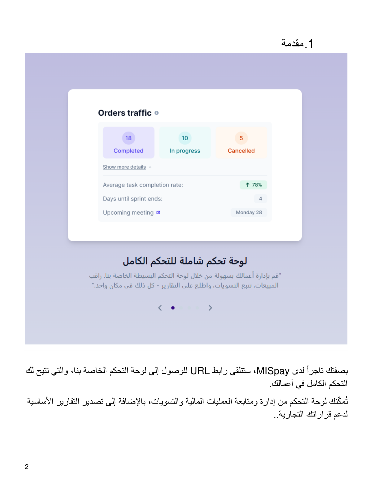

# لوحة التاجر --- دليل المستخدم {#لوحة-التاجر-دليل-المستخدم dir="rtl"}

::: {dir="rtl"}
## 1. مقدمة

بصفتك تاجرًا لدى **MISpay**، ستتلقى رابط URL للوصول إلى لوحة التحكم
الخاصة بنا، والتي تتيح لك التحكم الكامل في أعمالك.

تمكّنك لوحة التحكم من إدارة ومتابعة العمليات المالية والتسويات، بالإضافة
إلى تصدير التقارير الأساسية لدعم قراراتك التجارية.

### ما الذي يمكنك إدارته من لوحة التاجر؟

-   متابعة مؤشرات الأداء والعمليات المالية.
-   إدارة الطلبات ومراجعة تفاصيلها.
-   إجراء عمليات استرجاع المبالغ كليًا أو جزئيًا.
-   إنشاء طلبات جديدة للعمليات غير المتصلة بالمتجر الإلكتروني.
-   متابعة التسويات والمدفوعات والتقارير.
-   إدارة المستخدمين والأدوار والصلاحيات.
-   إدارة الفروع وبيانات الشركة.
:::

::: {dir="rtl"}
## الصور التوضيحية من الدليل الأصلي

{style="max-width:100%;"}

{style="max-width:100%;"}
:::

