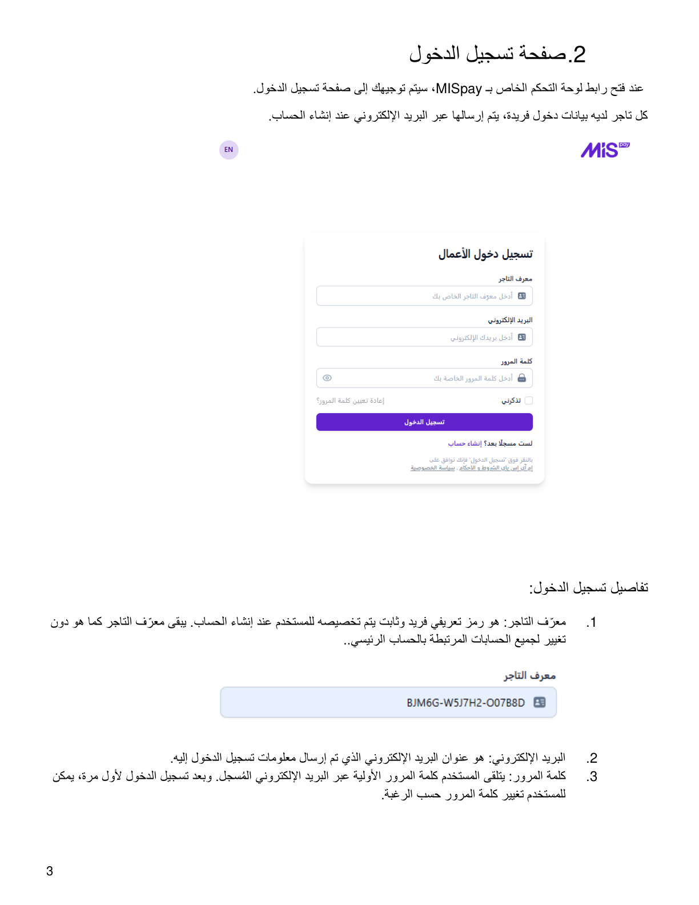
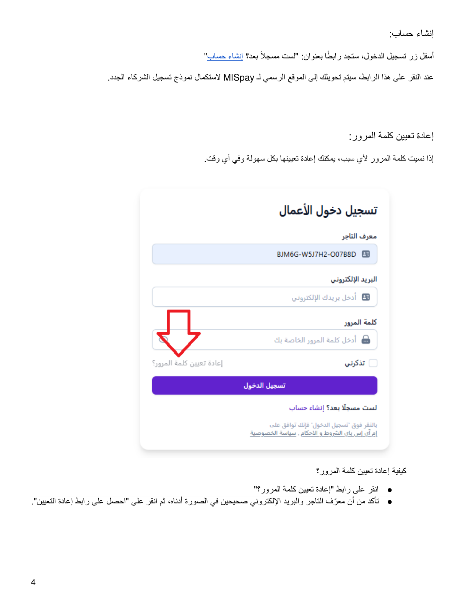
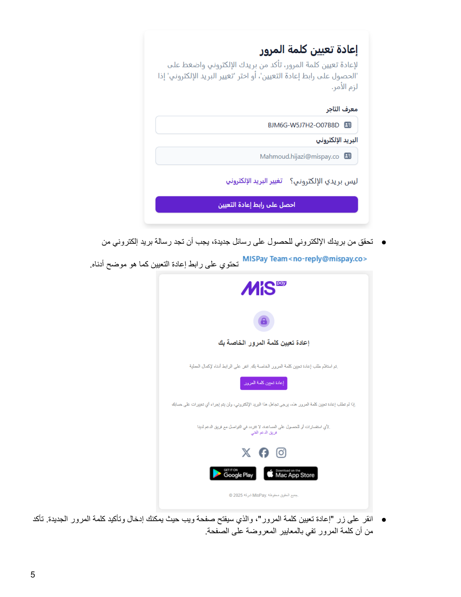
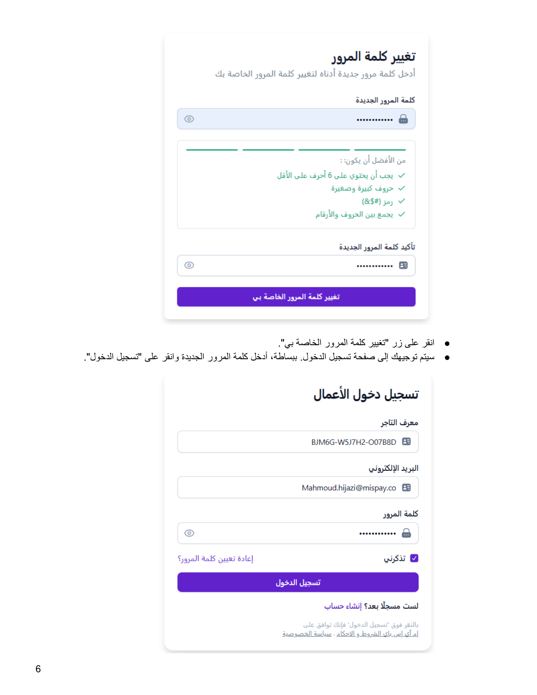

::: {dir="rtl"}
# 2. صفحة تسجيل الدخول

عند فتح رابط لوحة التحكم الخاص بـ **MISpay**، سيتم توجيهك إلى صفحة تسجيل
الدخول. كل تاجر لديه بيانات دخول فريدة، يتم إرسالها عبر البريد
الإلكتروني عند إنشاء الحساب.

## تفاصيل تسجيل الدخول

1.  **معرف التاجر:** رمز تعريفي فريد وثابت يتم تخصيصه للمستخدم عند إنشاء
    الحساب، ويبقى معرف التاجر دون تغيير لجميع الحسابات المرتبطة بالحساب
    الرئيسي.
2.  **البريد الإلكتروني:** عنوان البريد الإلكتروني الذي تم إرسال معلومات
    تسجيل الدخول إليه.
3.  **كلمة المرور:** يتلقى المستخدم كلمة المرور الأولية عبر البريد
    الإلكتروني المسجل. وبعد تسجيل الدخول لأول مرة، يمكن للمستخدم تغيير
    كلمة المرور حسب الرغبة.

## إنشاء حساب

أسفل زر تسجيل الدخول، ستجد رابطًا بعنوان **«لست مسجلًا بعد؟ إنشاء حساب»**.
عند النقر على هذا الرابط، سيتم تحويلك إلى الموقع الرسمي لـ MISpay
لاستكمال نموذج تسجيل الشركاء الجدد.

## إعادة تعيين كلمة المرور

إذا نسيت كلمة المرور، يمكنك إعادة تعيينها في أي وقت.

### الخطوات

1.  انقر على رابط **«إعادة تعيين كلمة المرور؟»**.
2.  تأكد من إدخال معرف التاجر والبريد الإلكتروني الصحيحين، ثم انقر على
    **«احصل على رابط إعادة التعيين»**.
3.  تحقق من بريدك الإلكتروني للحصول على رسالة جديدة تحتوي على رابط إعادة
    التعيين.
4.  انقر على زر **«إعادة تعيين كلمة المرور»**، ثم أدخل كلمة المرور
    الجديدة وأكدها. يجب أن تستوفي كلمة المرور المعايير المعروضة على
    الصفحة.
5.  انقر على **«تغيير كلمة المرور الخاصة بي»**.
6.  سيتم توجيهك إلى صفحة تسجيل الدخول. أدخل كلمة المرور الجديدة وانقر
    على **«تسجيل الدخول»**.
:::

::: {dir="rtl"}
## الصور التوضيحية من الدليل الأصلي

{style="max-width:100%;"}

{style="max-width:100%;"}

{style="max-width:100%;"}

{style="max-width:100%;"}
:::

