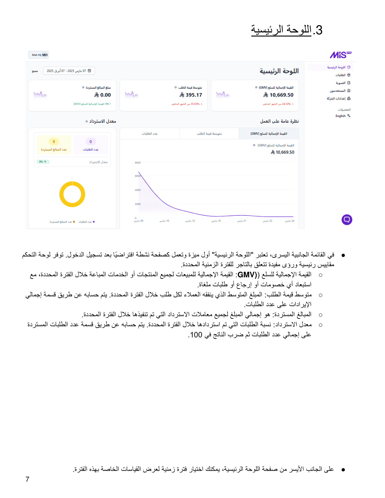
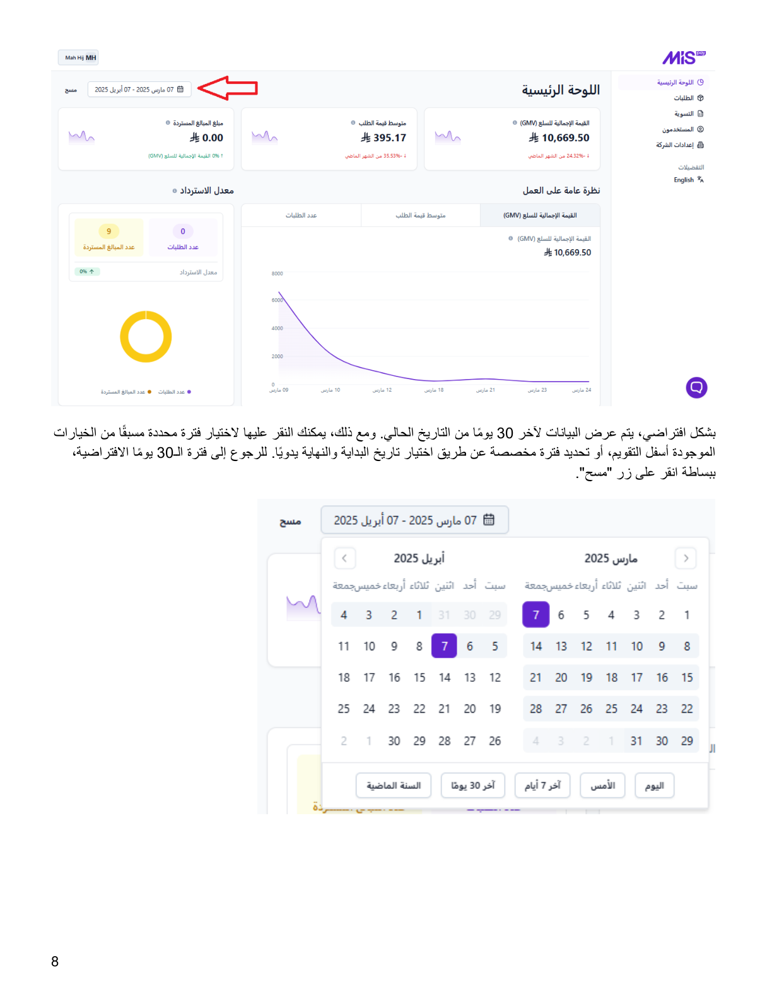

::: {dir="rtl"}
# 3. اللوحة الرئيسية

في القائمة الجانبية اليسرى، تعتبر **«اللوحة الرئيسية»** أول ميزة وتعمل
كصفحة نشطة افتراضيًا بعد تسجيل الدخول. توفر لوحة التحكم مقاييس رئيسية
ورؤى مفيدة تتعلق بالتاجر للفترة الزمنية المحددة.

## المقاييس الرئيسية

-   **القيمة الإجمالية للسلع (GMV):** القيمة الإجمالية للمبيعات لجميع
    المنتجات أو الخدمات المباعة خلال الفترة المحددة، مع استبعاد أي
    خصومات أو إرجاع أو طلبات ملغاة.
-   **متوسط قيمة الطلب:** المبلغ المتوسط الذي ينفقه العملاء لكل طلب خلال
    الفترة المحددة. يتم حسابه عن طريق قسمة إجمالي الإيرادات على عدد
    الطلبات.
-   **المبالغ المستردة:** إجمالي المبلغ لجميع معاملات الاسترداد التي تم
    تنفيذها خلال الفترة المحددة.
-   **معدل الاسترداد:** نسبة الطلبات التي تم استردادها خلال الفترة
    المحددة، ويتم حسابها بقسمة عدد الطلبات المستردة على إجمالي عدد
    الطلبات ثم ضرب الناتج في 100.

## اختيار الفترة الزمنية

يمكنك اختيار فترة زمنية لعرض القياسات الخاصة بهذه الفترة. بشكل افتراضي،
يتم عرض البيانات لآخر **30 يومًا** من التاريخ الحالي.

يمكنك اختيار فترة محددة مسبقًا من الخيارات الموجودة أسفل التقويم، أو
تحديد فترة مخصصة عن طريق اختيار تاريخ البداية والنهاية يدويًا. للرجوع إلى
فترة الـ30 يومًا الافتراضية، انقر على **«مسح»**.
:::

::: {dir="rtl"}
## الصور التوضيحية من الدليل الأصلي

{style="max-width:100%;"}

{style="max-width:100%;"}
:::

