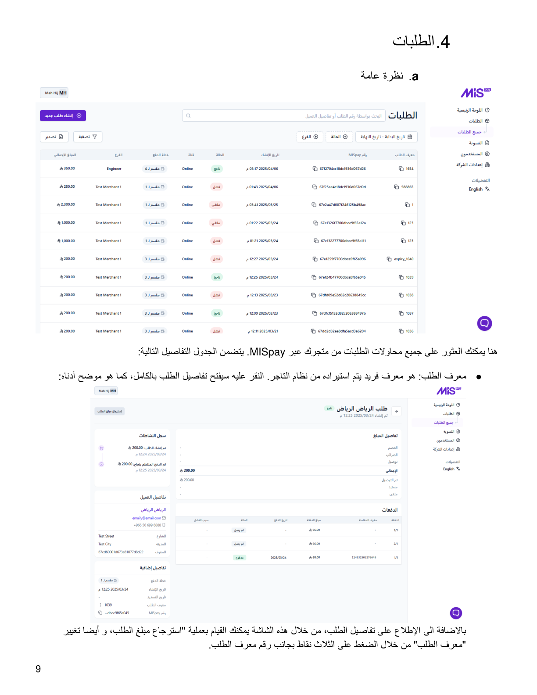
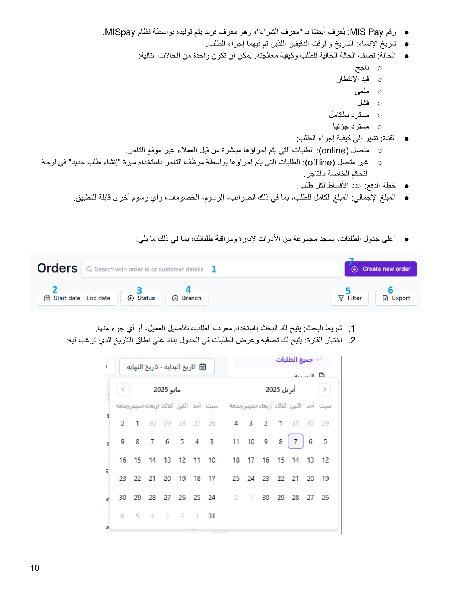
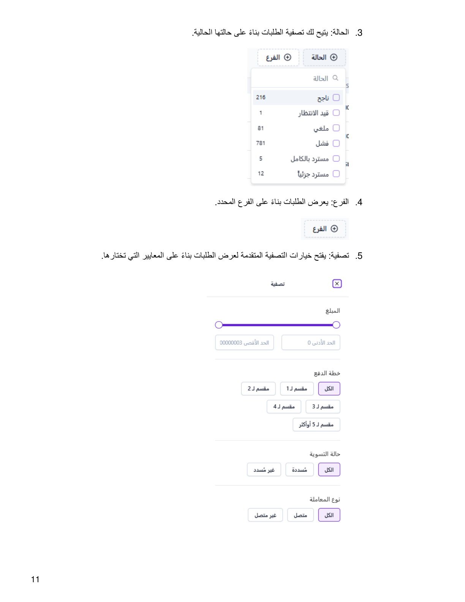
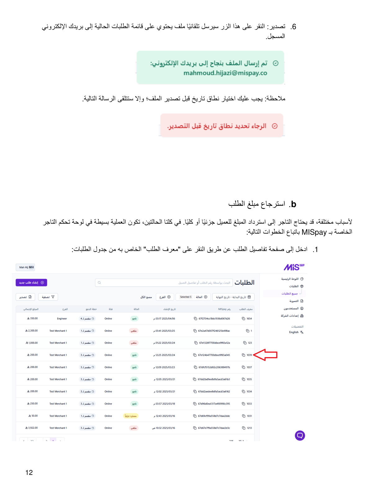
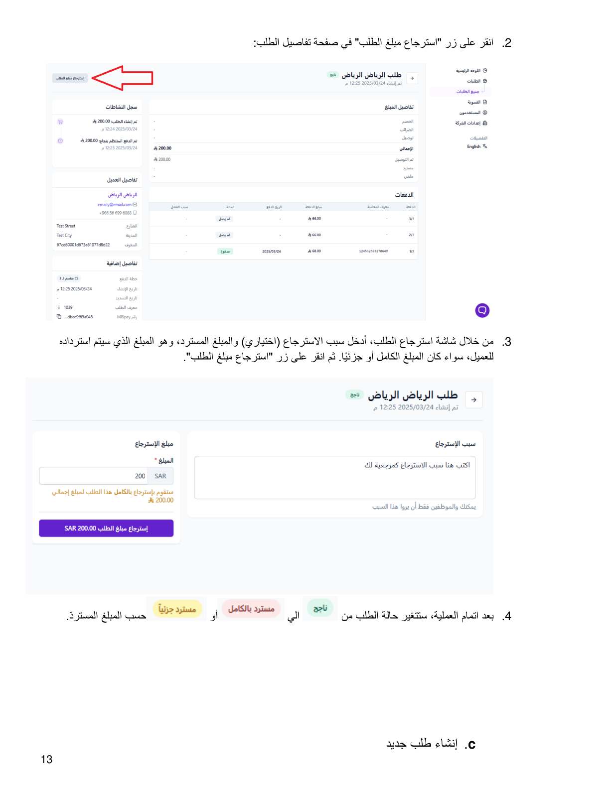
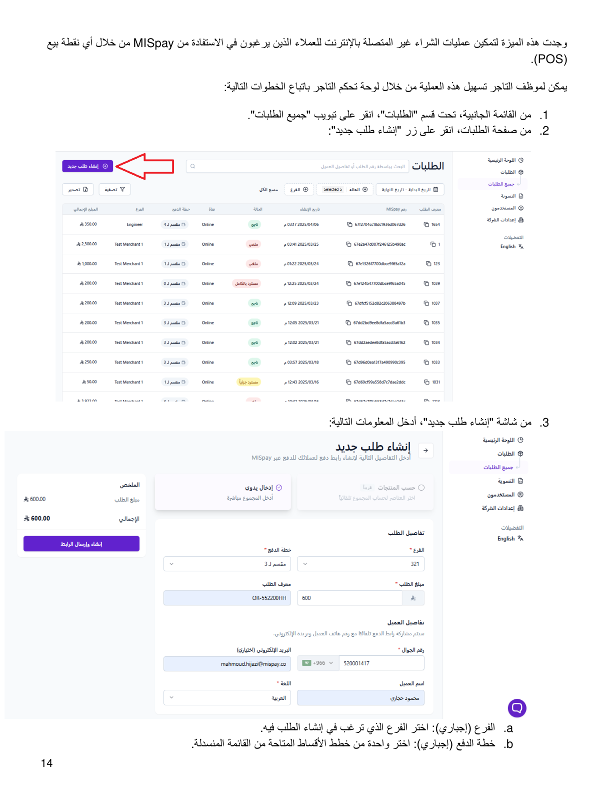
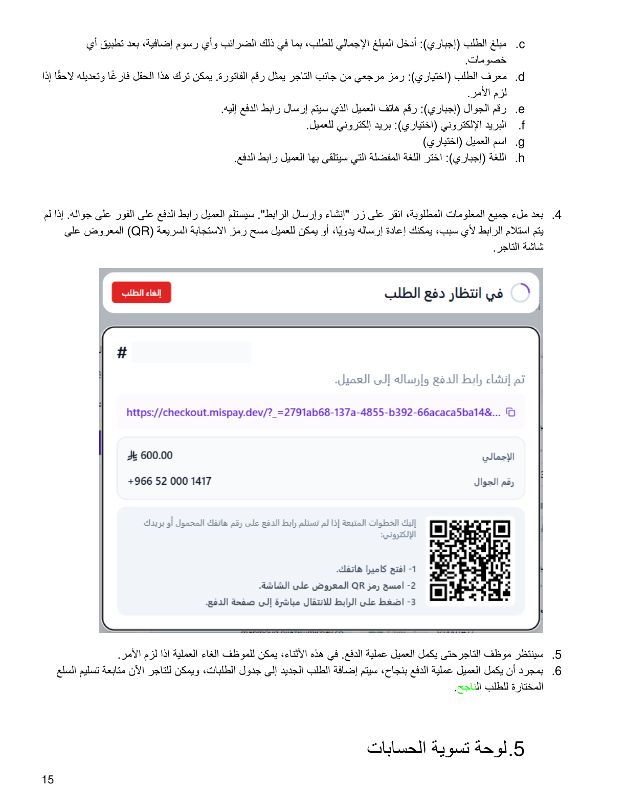

::: {dir="rtl"}
# 4. الطلبات

## أ. نظرة عامة

هنا يمكنك العثور على جميع محاولات الطلبات من متجرك عبر **MISpay**.

### تفاصيل الطلبات

-   **معرف الطلب:** معرف فريد يتم استيراده من نظام التاجر. النقر عليه
    يفتح تفاصيل الطلب بالكامل.
-   **رقم MIS Pay:** يُعرف أيضًا بـ«معرف الشراء»، وهو معرف فريد يتم توليده
    بواسطة نظام MISpay.
-   **تاريخ الإنشاء:** التاريخ والوقت الدقيقان اللذان تم فيهما إجراء
    الطلب.
-   **الحالة:** يمكن أن تكون ناجح، قيد الانتظار، ملغي، فشل، مسترد
    بالكامل، أو مسترد جزئيًا.
-   **القناة:** متصل (Online) للطلبات التي يجريها العملاء عبر موقع
    التاجر، أو غير متصل (Offline) للطلبات التي يجريها موظف التاجر
    باستخدام ميزة «إنشاء طلب جديد».
-   **خطة الدفع:** عدد الأقساط لكل طلب.
-   **المبلغ الإجمالي:** المبلغ الكامل للطلب، بما في ذلك الضرائب والرسوم
    والخصومات وأي رسوم أخرى قابلة للتطبيق.

### أدوات إدارة الطلبات

1.  **شريط البحث:** البحث باستخدام معرف الطلب أو تفاصيل العميل أو أي جزء
    منها.
2.  **اختيار الفترة:** تصفية وعرض الطلبات بناءً على نطاق التاريخ المطلوب.
3.  **الحالة:** تصفية الطلبات بناءً على حالتها الحالية.
4.  **الفرع:** عرض الطلبات بناءً على الفرع المحدد.
5.  **تصفية:** فتح خيارات التصفية المتقدمة لعرض الطلبات وفق المعايير
    المختارة.
6.  **تصدير:** إرسال ملف يحتوي على قائمة الطلبات الحالية إلى البريد
    الإلكتروني المسجل. يجب اختيار نطاق تاريخ قبل التصدير.

## ب. استرجاع مبلغ الطلب

يمكن للتاجر استرداد المبلغ للعميل جزئيًا أو كليًا من خلال لوحة تحكم
التاجر.

1.  ادخل إلى صفحة تفاصيل الطلب عن طريق النقر على **«معرف الطلب»** من
    جدول الطلبات.
2.  انقر على زر **«استرجاع مبلغ الطلب»**.
3.  أدخل سبب الاسترجاع (اختياري) والمبلغ المسترد، سواء كان المبلغ كاملًا
    أو جزئيًا، ثم انقر على **«استرجاع مبلغ الطلب»**.
4.  بعد إتمام العملية، ستتغير حالة الطلب وفقًا للمبلغ المسترد.

## ج. إنشاء طلب جديد

تتيح هذه الميزة عمليات الشراء غير المتصلة بالإنترنت للعملاء الذين يرغبون
في الاستفادة من MISpay من خلال أي نقطة بيع (POS).

1.  من القائمة الجانبية، تحت قسم **«الطلبات»**، انقر على تبويب **«جميع
    الطلبات»**.
2.  من صفحة الطلبات، انقر على زر **«إنشاء طلب جديد»**.
3.  أدخل المعلومات التالية:
    -   **الفرع (إجباري):** اختر الفرع الذي ترغب في إنشاء الطلب فيه.
    -   **خطة الدفع (إجباري):** اختر إحدى خطط الأقساط المتاحة.
    -   **مبلغ الطلب (إجباري):** أدخل المبلغ الإجمالي للطلب، بما في ذلك
        الضرائب وأي رسوم إضافية، بعد تطبيق الخصومات.
    -   **معرف الطلب (اختياري):** رمز مرجعي من جانب التاجر يمثل رقم
        الفاتورة، ويمكن تركه فارغًا وتعديله لاحقًا إذا لزم الأمر.
    -   **رقم الجوال (إجباري):** رقم هاتف العميل الذي سيتم إرسال رابط
        الدفع إليه.
    -   **البريد الإلكتروني (اختياري):** بريد إلكتروني للعميل.
    -   **اسم العميل (اختياري).**
    -   **اللغة (إجباري):** اللغة المفضلة التي سيتلقى بها العميل رابط
        الدفع.
4.  بعد ملء المعلومات المطلوبة، انقر على **«إنشاء وإرسال الرابط»**.
    سيستلم العميل رابط الدفع على جواله فورًا. إذا لم يتم استلام الرابط،
    يمكن إعادة إرساله يدويًا، أو يمكن للعميل مسح رمز QR المعروض على شاشة
    التاجر.
5.  ينتظر موظف التاجر حتى يكمل العميل عملية الدفع، ويمكن للموظف إلغاء
    العملية إذا لزم الأمر.
6.  بعد إكمال الدفع بنجاح، تتم إضافة الطلب الجديد إلى جدول الطلبات،
    ويمكن للتاجر متابعة تسليم السلع المختارة للطلب الناجح.
:::

::: {dir="rtl"}
## الصور التوضيحية من الدليل الأصلي

{style="max-width:100%;"}

{style="max-width:100%;"}

{style="max-width:100%;"}

{style="max-width:100%;"}

{style="max-width:100%;"}

{style="max-width:100%;"}

{style="max-width:100%;"}
:::

