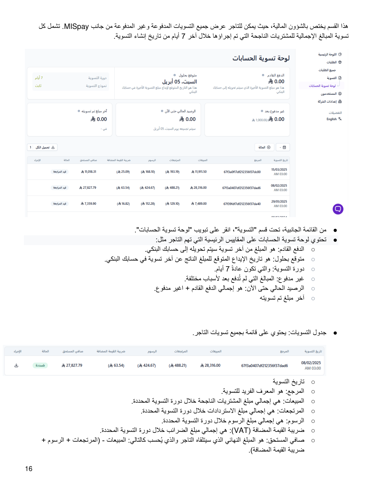
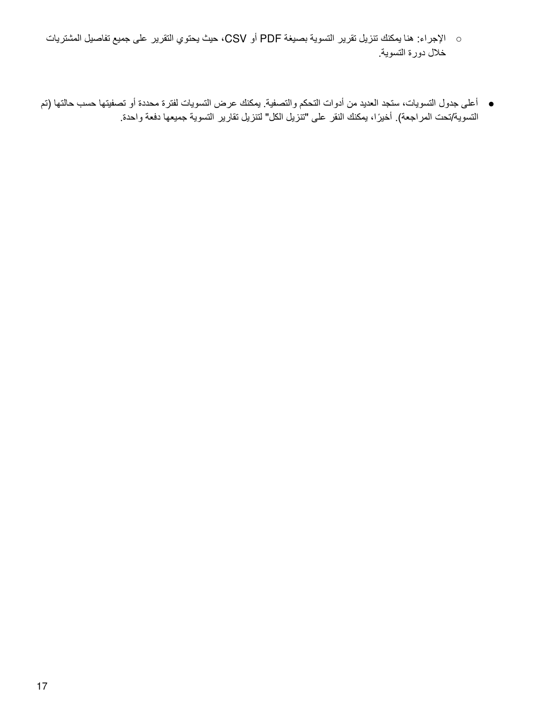

::: {dir="rtl"}
# 5. لوحة تسوية الحسابات

هذا القسم مختص بالشؤون المالية، حيث يمكن للتاجر عرض جميع التسويات
المدفوعة وغير المدفوعة من جانب **MISpay**. تشمل كل تسوية المبالغ
الإجمالية للمشتريات الناجحة التي تم إجراؤها خلال آخر **7 أيام** من تاريخ
إنشاء التسوية.

## المقاييس الرئيسية

-   **الدفع القادم:** المبلغ من آخر تسوية سيتم تحويله إلى حسابك البنكي.
-   **متوقع بحلول:** تاريخ الإيداع المتوقع للمبلغ الناتج عن آخر تسوية في
    حسابك البنكي.
-   **دورة التسوية:** عادةً 7 أيام.
-   **غير مدفوع:** المبالغ التي لم تُدفع بعد لأسباب مختلفة.
-   **الرصيد الحالي حتى الآن:** إجمالي الدفع القادم + غير مدفوع.
-   **آخر مبلغ تم تسويته.**

## جدول التسويات

يحتوي جدول التسويات على قائمة بجميع تسويات التاجر، وتشمل:

-   **تاريخ التسوية.**
-   **المرجع:** المعرف الفريد للتسوية.
-   **المبيعات:** إجمالي مبلغ المشتريات الناجحة خلال دورة التسوية
    المحددة.
-   **المرتجعات:** إجمالي مبلغ الاستردادات خلال دورة التسوية المحددة.
-   **الرسوم:** إجمالي مبلغ الرسوم خلال دورة التسوية المحددة.
-   **ضريبة القيمة المضافة (VAT):** إجمالي مبلغ الضرائب خلال دورة
    التسوية المحددة.
-   **صافي المستحق:** المبلغ النهائي الذي سيتلقاه التاجر، ويُحسب كالتالي:
    المبيعات - (المرتجعات + الرسوم + ضريبة القيمة المضافة).
-   **الإجراء:** تنزيل تقرير التسوية بصيغة PDF أو CSV، ويحتوي التقرير
    على جميع تفاصيل المشتريات خلال دورة التسوية.

يمكن عرض التسويات لفترة محددة أو تصفيتها حسب حالتها (تم التسوية / تحت
المراجعة). كما يمكن النقر على **«تنزيل الكل»** لتنزيل تقارير التسوية
جميعها دفعة واحدة.
:::

::: {dir="rtl"}
## الصور التوضيحية من الدليل الأصلي

{style="max-width:100%;"}

{style="max-width:100%;"}
:::

