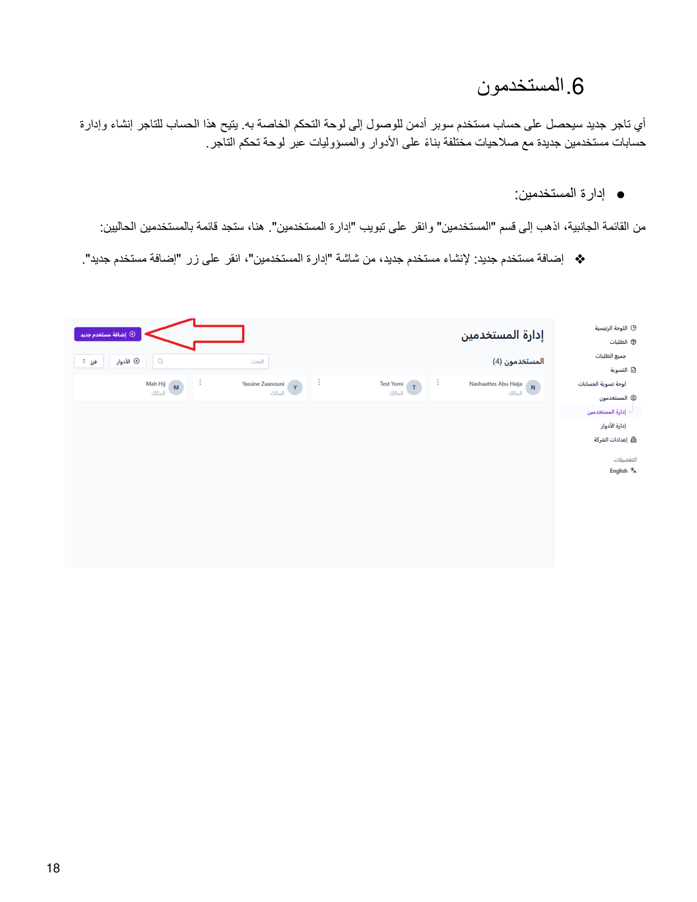
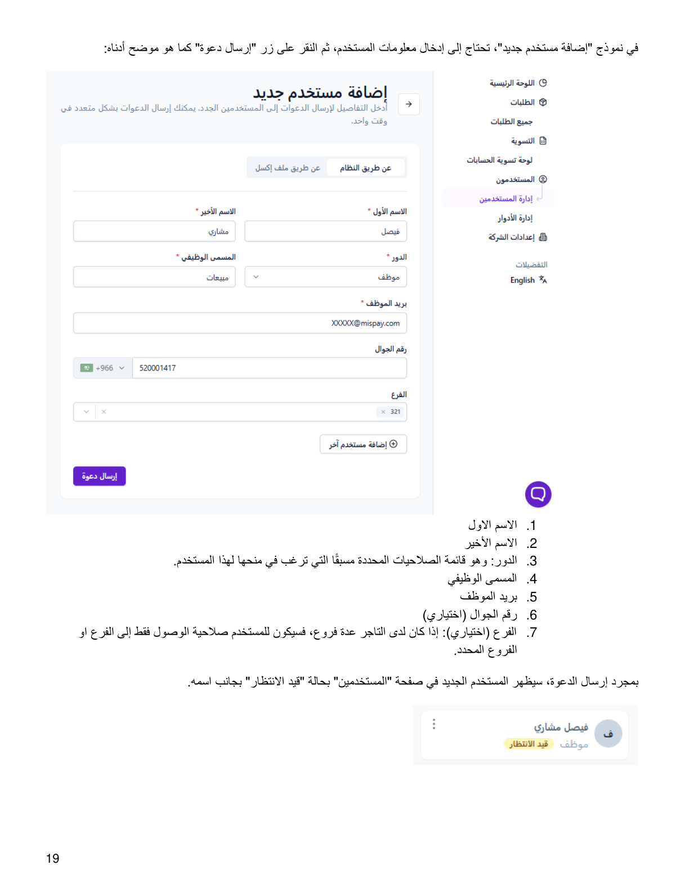
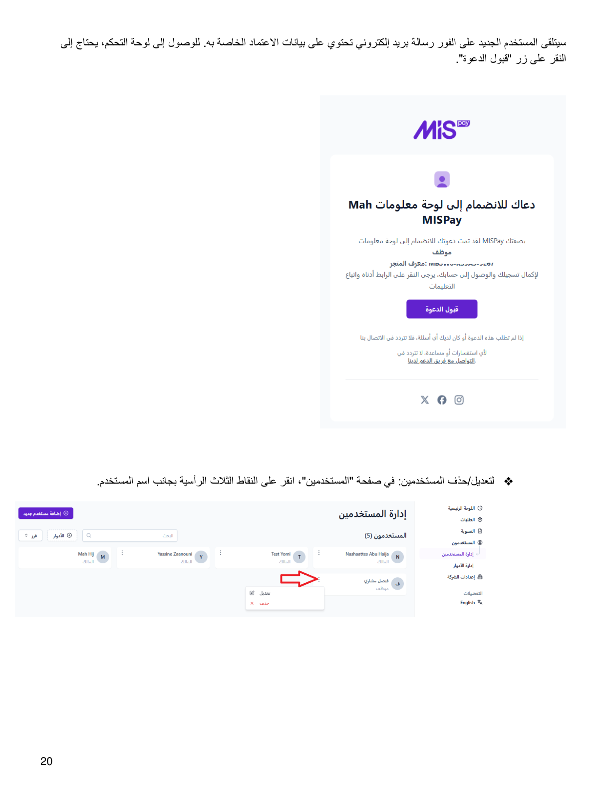
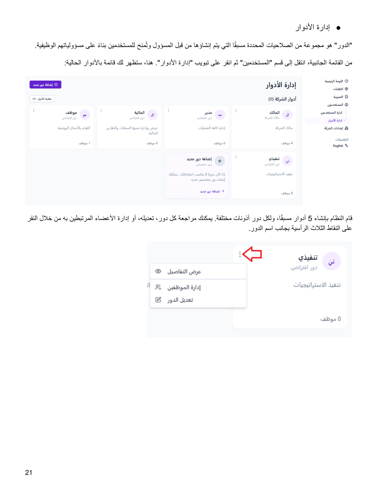
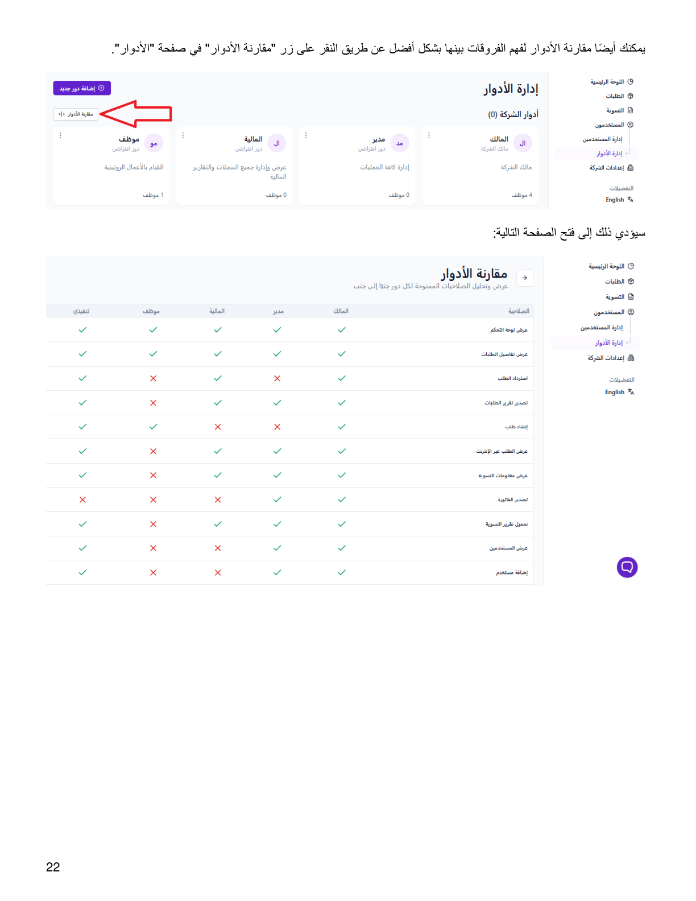
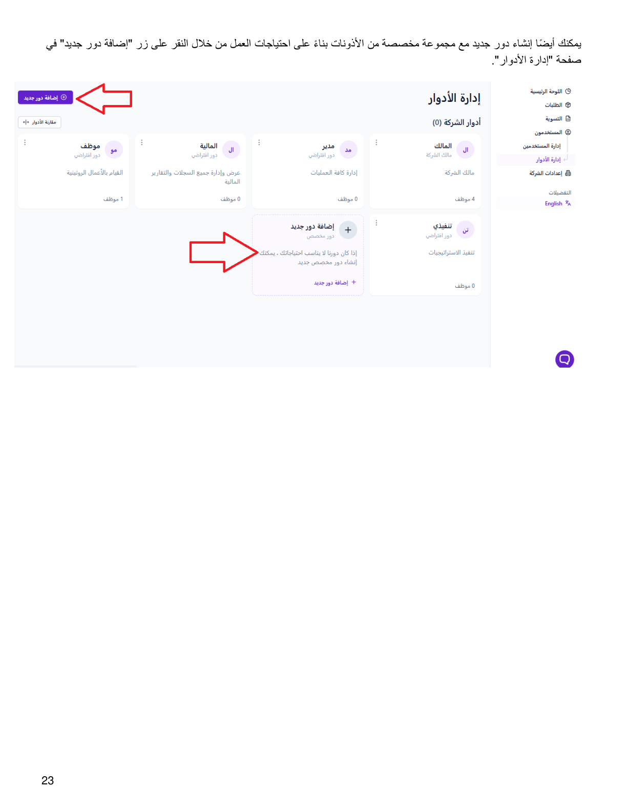
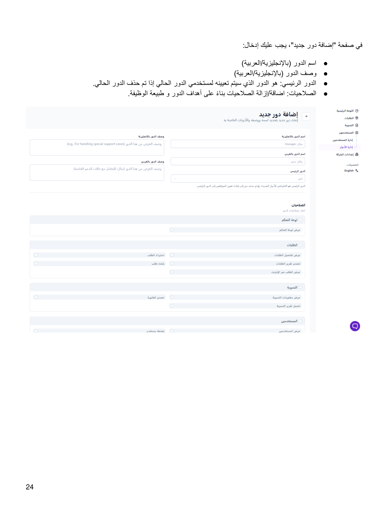

::: {dir="rtl"}
# 6. المستخدمون

أي تاجر جديد سيحصل على حساب مستخدم **سوبر أدمن** للوصول إلى لوحة التحكم
الخاصة به. يتيح هذا الحساب للتاجر إنشاء وإدارة حسابات مستخدمين جديدة مع
صلاحيات مختلفة بناءً على الأدوار والمسؤوليات.

## أ. إدارة المستخدمين

من القائمة الجانبية، اذهب إلى قسم **«المستخدمين»** وانقر على تبويب
**«إدارة المستخدمين»** لعرض قائمة المستخدمين الحاليين.

### إضافة مستخدم جديد

من شاشة «إدارة المستخدمين»، انقر على زر **«إضافة مستخدم جديد»**. في
النموذج، أدخل:

1.  الاسم الأول.
2.  الاسم الأخير.
3.  **الدور:** قائمة الصلاحيات المحددة مسبقًا التي ترغب في منحها
    للمستخدم.
4.  المسمى الوظيفي.
5.  بريد الموظف.
6.  رقم الجوال (اختياري).
7.  الفرع (اختياري): إذا كان لدى التاجر عدة فروع، فسيكون للمستخدم صلاحية
    الوصول فقط إلى الفرع أو الفروع المحددة.

بعد إرسال الدعوة، سيظهر المستخدم الجديد في صفحة «المستخدمين» بحالة
**«قيد الانتظار»**. سيتلقى المستخدم رسالة بريد إلكتروني تحتوي على بيانات
الاعتماد، وللوصول إلى لوحة التحكم يحتاج إلى النقر على **«قبول الدعوة»**.

### تعديل أو حذف مستخدم

في صفحة «المستخدمين»، انقر على النقاط الثلاث الرأسية بجانب اسم المستخدم
لتعديل المستخدم أو حذفه.

## ب. إدارة الأدوار

**الدور** هو مجموعة من الصلاحيات المحددة مسبقًا التي يتم إنشاؤها من قبل
المسؤول وتُمنح للمستخدمين بناءً على مسؤولياتهم الوظيفية.

من القائمة الجانبية، انتقل إلى قسم «المستخدمين» ثم انقر على تبويب
**«إدارة الأدوار»**.

قام النظام بإنشاء **5 أدوار** مسبقًا، ولكل دور أذونات مختلفة. يمكنك
مراجعة كل دور أو تعديله أو إدارة الأعضاء المرتبطين به من خلال النقر على
النقاط الثلاث الرأسية بجانب اسم الدور.

### مقارنة الأدوار

يمكنك مقارنة الأدوار لفهم الفروقات بينها بشكل أفضل عن طريق النقر على زر
**«مقارنة الأدوار»** في صفحة الأدوار.

### إضافة دور جديد

يمكنك إنشاء دور جديد مع مجموعة مخصصة من الأذونات بناءً على احتياجات العمل
من خلال النقر على زر **«إضافة دور جديد»** في صفحة «إدارة الأدوار».

في صفحة «إضافة دور جديد»، يجب إدخال:

-   **اسم الدور** (بالإنجليزية / العربية).
-   **وصف الدور** (بالإنجليزية / العربية).
-   **الدور الرئيسي:** الدور الذي سيتم تعيينه لمستخدمي الدور الحالي إذا
    تم حذف الدور الحالي.
-   **الصلاحيات:** إضافة / إزالة الصلاحيات بناءً على أهداف الدور وطبيعة
    الوظيفة.
:::

::: {dir="rtl"}
## الصور التوضيحية من الدليل الأصلي

{style="max-width:100%;"}

{style="max-width:100%;"}

{style="max-width:100%;"}

{style="max-width:100%;"}

{style="max-width:100%;"}

{style="max-width:100%;"}

{style="max-width:100%;"}
:::

