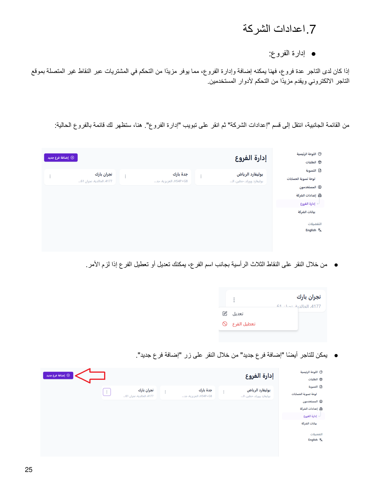
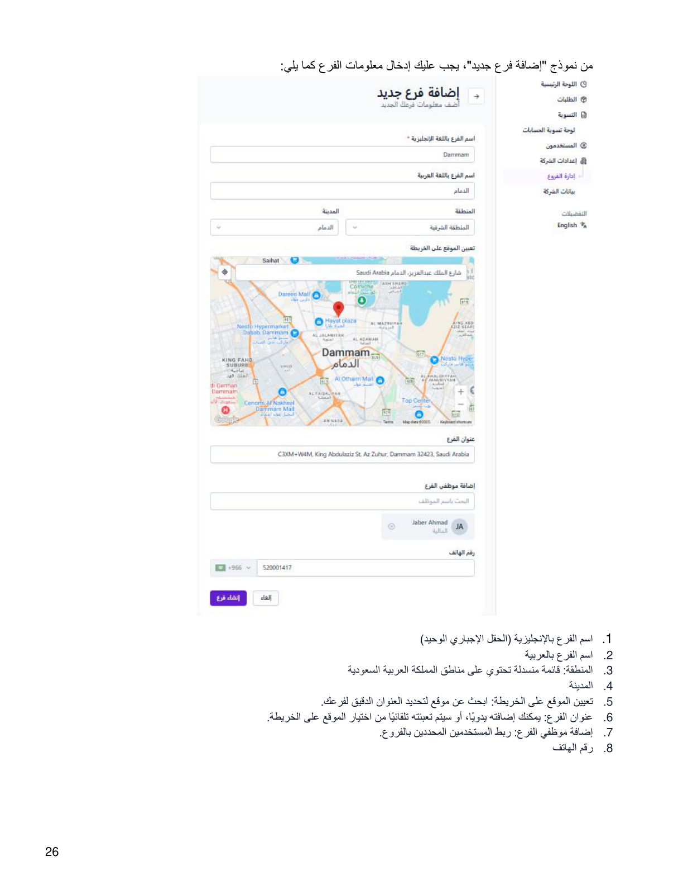
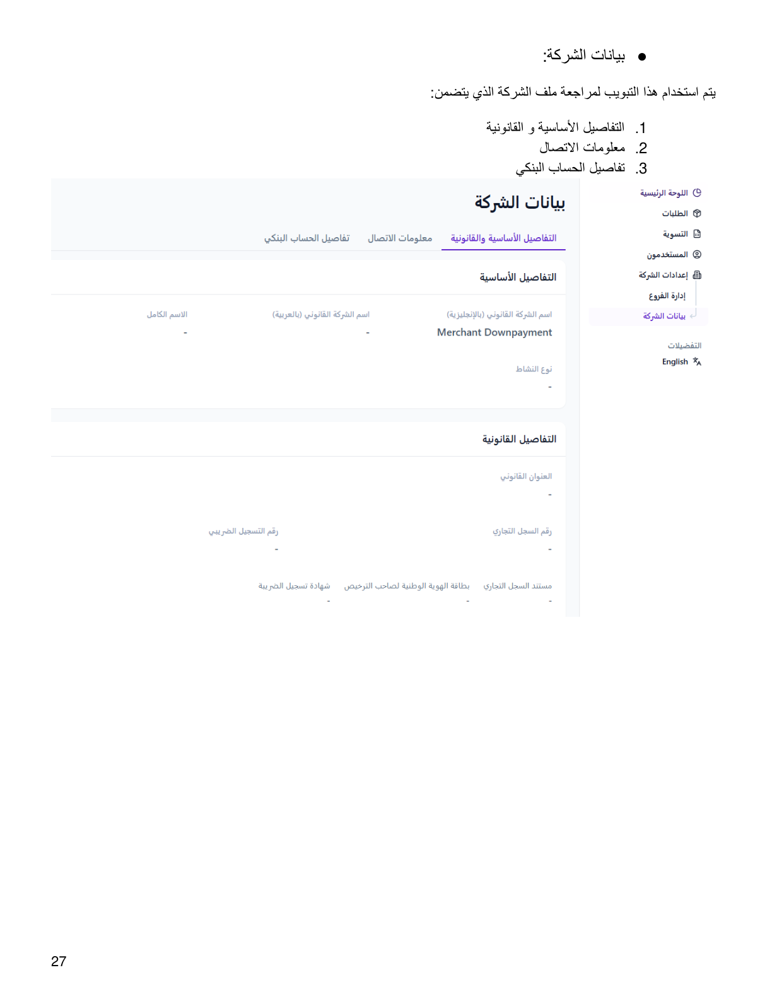

::: {dir="rtl"}
# 7. إعدادات الشركة

## أ. إدارة الفروع

إذا كان لدى التاجر عدة فروع، يمكنه إضافة وإدارة الفروع، مما يوفر مزيدًا
من التحكم في المشتريات عبر النقاط غير المتصلة بموقع التاجر الإلكتروني،
ويقدم مزيدًا من التحكم لأدوار المستخدمين.

من القائمة الجانبية، انتقل إلى قسم **«إعدادات الشركة»** ثم انقر على
تبويب **«إدارة الفروع»**.

-   يمكنك تعديل أو تعطيل الفرع من خلال النقر على النقاط الثلاث الرأسية
    بجانب اسم الفرع.
-   يمكنك إضافة فرع جديد من خلال النقر على زر **«إضافة فرع جديد»**.

### إضافة فرع جديد

من نموذج «إضافة فرع جديد»، يجب إدخال معلومات الفرع التالية:

1.  **اسم الفرع بالإنجليزية** --- الحقل الإجباري الوحيد.
2.  اسم الفرع بالعربية.
3.  **المنطقة:** قائمة منسدلة تحتوي على مناطق المملكة العربية السعودية.
4.  المدينة.
5.  **تعيين الموقع على الخريطة:** البحث عن موقع لتحديد العنوان الدقيق
    للفرع.
6.  **عنوان الفرع:** يمكن إضافته يدويًا، أو يتم تعبئته تلقائيًا من اختيار
    الموقع على الخريطة.
7.  **إضافة موظفي الفرع:** ربط المستخدمين المحددين بالفروع.
8.  رقم الهاتف.

## ب. بيانات الشركة

يتم استخدام هذا التبويب لمراجعة ملف الشركة الذي يتضمن:

1.  التفاصيل الأساسية والقانونية.
2.  معلومات الاتصال.
3.  تفاصيل الحساب البنكي.
:::

::: {dir="rtl"}
## الصور التوضيحية من الدليل الأصلي

{style="max-width:100%;"}

{style="max-width:100%;"}

{style="max-width:100%;"}
:::

